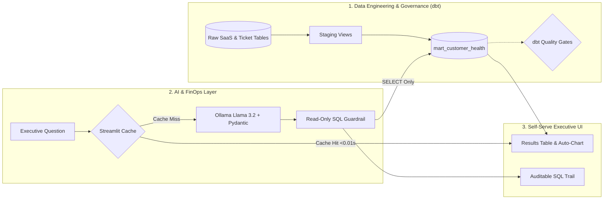

# Executive Data Assistant

A governed natural-language analytics app built with Python, DuckDB, Streamlit, and OpenAI. Non-technical leaders can ask plain-English business questions and receive audited SQL queries, structured data tables, and automatic charts.

## Key Capabilities

* **Multi-Table Relational Joins:** Connects `subscriptions` (MRR, customer segments, churn reasons) with `support_tickets` (priority, resolution hours, CSAT scores) via `customer_id` for cross-functional insights.
* **Automated Visual Summaries:** Inspects query outputs and automatically renders bar charts when categorical labels are paired with numeric metrics, while filtering out ID fields.
* **Built-In Governance:** Uses read-only DuckDB connections (`read_only=True`), deterministic prompting (`temperature=0`), and an expandable SQL audit trail so leaders can verify every number.

## Data Model

## Governed Semantic Layer & Data Model

Powered by the dbt transformation pipeline at https://github.com/womacwe1/customer-health-dbt:

* mart_customer_health: Certified table combining SaaS revenue (MRR, ARR, segment, region, status) with support metrics (total_tickets, critical_tickets, avg_resolution_hours, avg_csat_score)

## Quickstart

1. **Clone and set up the environment:**
   ```bash
   git clone https://github.com
   cd exec-data-chat
   python -m venv venv
   venv\Scripts\activate
   pip install -r requirements.txt
   ```

2. **Seed the local database:**
   ```bash
   python setup_db.py
   ```

3. **Run the app:**
   ```bash
   streamlit run app.py
   ```

## Example Prompts to Try

* *"Compare average ticket resolution hours and CSAT scores between Active and Churned customers."*
* *"Which churned companies had Critical support tickets, and what was their MRR?"*
* *"Show total MRR by customer segment."*

## Scaling Roadmap

* **Cloud Warehouse:** Replace DuckDB with Snowflake or Databricks using read-only RBAC service accounts.
* **Semantic Layer:** Feed dbt `manifest.json` definitions into the prompt context for standardized business metrics.
* **FinOps & Testing:** Add query caching to lower token usage and a golden-dataset test suite to track SQL accuracy.

$diagram = @"

## System Architecture


"@
Add-Content -Path README.md -Value $diagram

